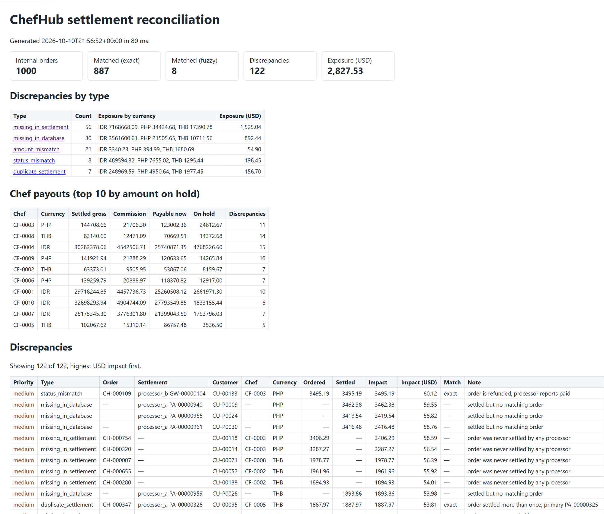

# ChefHub Settlement Reconciliation

Reconciles ChefHub's internal orders against settlement reports from two payment processors, finds every
discrepancy, calculates the money at risk and shows how much each chef can be paid now.

Solution to the Yuno backend challenge "The ChefHub Batch Settlement Nightmare".



## Quick start

Requires Docker and `make`. PHP runs inside the containers.

```bash
make start            # start the containers
make reconcile-demo   # generate 1,000 sample orders and reconcile them
```

Open **http://localhost/reconciliation** to see the report. The same report is written to `var/reports/latest/`.

To reconcile your own files:

```bash
make exec cmd="php bin/console app:reconcile \
  --internal=path/internal_orders.csv \
  --processor-a=path/processor_a_settlement.csv \
  --processor-b=path/processor_b_settlement.json \
  --out=var/reports"
```

Without running anything: inputs are in [`data/sample/`](data/sample/), a generated report is in
[`docs/example-report/`](docs/example-report/).

## Console output

```
$ make reconcile-demo

ChefHub settlement reconciliation
=================================

 ----------------- -------
  Internal orders   1000
  Settlements       961
  Matched (exact)   887
  Matched (fuzzy)   8
  Warnings          1
  Duration          78 ms
 ----------------- -------

 ----------------------- ------- ----------------
  Discrepancy type        Count   Exposure (USD)
 ----------------------- ------- ----------------
  missing_in_settlement   56      1,525.04
  missing_in_database     30      892.44
  amount_mismatch         21      54.90
  status_mismatch         8       198.45
  duplicate_settlement    7       156.70
  TOTAL                   122     2,827.53
 ----------------------- ------- ----------------

 [OK] Report written to var/reports/latest
```

The generator records how many discrepancies of each type it seeded (`data/sample/manifest.json`). The engine
finds exactly that number for every type.

## How it works

```
internal_orders.csv ──┐
processor_a.csv ──────┼─► readers ─► Transaction ─► 1. exact match by order ref
processor_b.json ─────┘   (normalize)                2. fuzzy match for the rest
                                                     3. classify each order
                                                            │
                          report.json, discrepancies.csv, chef_payouts.csv, /reconciliation
```

### Sources

Each source has its own field names, formats and statuses. Readers convert them to one `Transaction`: canonical
order ID, amount in integer minor units, UTC time, status `paid` / `refunded` / `cancelled`.

| | Internal orders | Processor A (card) | Processor B (e-wallet) |
|---|---|---|---|
| Format | CSV | CSV | JSON |
| Order reference | `order_id` (`CH-000123`) | `merchant_order_ref` | `merchant.order_ref`, sometimes `ch123` or `null` |
| Amount | `total_amount` (`1234.50`) | `amount_minor` (cents) | `total` (`"1234.5"`) |
| Time | `paid_at` (ISO 8601, local offset) | `txn_time` (`d/m/Y H:i:s`, UTC) | `timestamp` (unix) |
| Status | `completed` / `refunded` / `cancelled` | `SETTLED` / `REFUNDED` | `success` / `refunded` |

Three currencies (PHP, IDR, THB), one week of data, about 60 % of orders through A and 40 % through B.

A malformed row is skipped and reported as a warning with file, row and reason. A repeated processor row (same
transaction ID) is counted once and reported. A missing or unreadable file stops the run with exit code 1.

### Matching

1. **Exact:** the settlement's order reference is normalized (`ch123` → `CH-000123`) and looked up in a hash index.
2. **Fuzzy** (for settlements without a usable reference): same currency, same amount, same customer and payment
   time within 5 seconds, only against orders that have no settlement yet. If more than one order fits, nothing is
   matched and a warning is reported: a wrong match would hide money.
3. **Classify** every order and every leftover settlement:

| Type | Rule | Money at risk |
|---|---|---|
| `missing_in_settlement` | paid or refunded order that no processor settled | order amount |
| `missing_in_database` | settlement with no matching order (phantom charge) | settled amount |
| `amount_mismatch` | amounts differ by more than 0.05, or the currencies differ | the difference |
| `status_mismatch` | refunded on one side only, or a cancelled order that was charged | settled amount |
| `duplicate_settlement` | one order settled twice, by the same or by different processors | each extra settlement |

The challenge lists four types and asks for five; the fifth is duplicate charges, which the brief names as a kind
of phantom transaction.

Exposure is shown per currency and in USD at fixed indicative rates (PHP 0.0172, IDR 0.000061, THB 0.0285).
Priority by USD: **high** ≥ 100, **medium** ≥ 10, **low** below. All lists are sorted by USD impact.

### Chef payouts

Per chef: `settled_gross` (orders paid on both sides with no discrepancy), `commission` (15 %), `payable_now`,
`on_hold` (orders with any discrepancy) and `discrepancy_count`. Sorted by the amount on hold in USD.

## Output

| File | Content |
|---|---|
| `report.json` | `summary` (counts, matches, exposure by type and currency), `insights` (top 20, type × processor, priorities), `chef_payouts`, `discrepancies`, `warnings`, `meta` (inputs, duration, memory) |
| `discrepancies.csv` | one row per discrepancy: type, priority, order, settlement, customer, chef, amounts, impact, note |
| `chef_payouts.csv` | one row per chef and currency |

Reports go to `var/reports/<timestamp>/` and are copied to `var/reports/latest/`, which the page reads. CSV cells
that a spreadsheet would run as a formula are prefixed with `'`.

## Performance

| Dataset | Orders | Settlements | Time | Peak memory |
|---|---|---|---|---|
| `make reconcile-demo` | 1,000 | 961 | 0.08 s | — |
| `make reconcile-full` | 45,600 | 44,190 (47K transactions in total) | 1.4 s | 157 MB |

Measured in the `symfony` container with Xdebug off. Matching is O(n) through hash indexes; most of the time is
parsing.

**Scaling.** Objects take about 68 MB per 100K transactions, so 500K fits in the 2 GB CLI memory limit. Beyond that:

1. Partition by currency and settlement week and run partitions in parallel (Messenger and RabbitMQ are already in
   the stack).
2. Stream the readers (they already read row by row) and merge-join sorted files instead of holding everything in
   memory.
3. Or load each source into indexed MySQL staging tables and reconcile with SQL joins, keeping only discrepancies.

## Project layout

```
src/Reconciliation/
  Model/        Transaction, Money, Currency, FxRates, enums, result objects
  Ingestion/    one reader per source, CSV parsing, order reference normalization
  Matching/     Reconciler: exact and fuzzy matching, classification (no I/O)
  Report/       report builder, chef payouts, JSON and CSV writers
  TestData/     deterministic test data generator with a manifest
src/Command/    app:reconcile, app:generate-test-data
src/Controller/ GET /reconciliation
tests/          Unit, Integration (commands, end to end), Application (HTTP)
data/sample/    test data: 3 sources + manifest.json
```

## Tests

```bash
make phpunit   # 88 tests, coverage report in reports/coverage/
make phpstan   # level max
make ecs       # coding standard
```

- **Unit:** each reader (formats, malformed rows, BOM and CRLF, duplicates), every discrepancy rule including the
  0.05 boundary, fuzzy matching and ambiguity, mixed currencies, chef payouts, report totals.
- **Integration:** `app:reconcile` on hand-written fixtures, missing input file, unwritable output directory.
- **End to end:** generate 3,000 orders, reconcile, and compare every count with the generator's manifest.
- **Application:** the report page, filtering by type, no report yet.

Line coverage of `src/`: 96.8 %.

## Design decisions

- **No database.** Reconciliation is a batch join; doing it in memory keeps the engine simple and fast. Persistence
  and run history are the next step, not part of this solution.
- **Money as integers.** Amounts are minor units; floats are used only for the indicative USD figures.
- **Pure core.** `Reconciler` takes transactions and returns a result. Reading files and writing reports stay at the
  edges, so the rules are tested without I/O.
- **Ambiguity is reported, not guessed.** Unclear fuzzy matches stay open for a person to check.
- **Proof by manifest.** Correctness is checked by comparing seeded and found discrepancies, not by eye.

## Known limitations

- The amount tolerance is 0.05 for every currency, as in the brief; differences of 0.01–0.05 count as matched.
- A settlement without a reference for an order that already has a settlement is reported as `missing_in_database`,
  not as a duplicate.
- A header with quoted column names after a UTF-8 BOM is not recognized (a plain Excel BOM is).
- An output directory that exists but is not writable fails with a PHP warning instead of a short message.
- Runs are not idempotent: each run writes a new timestamped folder.
